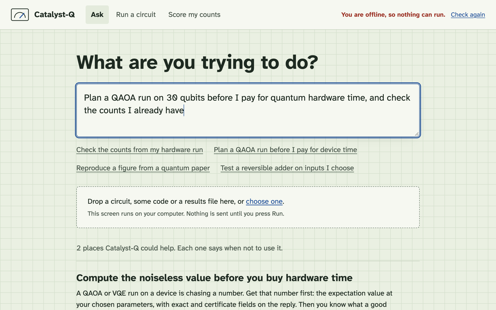

# Catalyst-Q

**Send a quantum circuit. Get the exact answer back, or a refusal that shows you the numbers.**

Catalyst-Q is a hosted API that runs quantum circuits on classical hardware. It is not a quantum computer. This repo holds the client tools: an SDK, a command line, an MCP server for agents, a GitHub Action and a desktop app. All of them work without an account.



## Try it now, with no account

Run a Bell pair:

```sh
curl -s https://catalyst-q.strategic-innovations.ai/api/v1/try \
  -H 'content-type: application/json' \
  -d '{"mode":"execute","qasm":"OPENQASM 3.0; qubit[2] q; h q[0]; cx q[0], q[1];","measure":[0,1]}'
```

Or from a file:

```sh
npx catalyst-q run examples/bell.qasm --measure 0,1
```

Or in TypeScript:

```sh
npm install catalyst-q
```

```ts
import { CatalystQ, settle } from "catalyst-q";

const q = new CatalystQ();
const out = await settle(q.run({ qasm: "OPENQASM 3.0; qubit[2] q; h q[0]; cx q[0], q[1];", measure: [0, 1] }));

if (out.kind === "answer") console.log(out.reply.result.probabilities);
if (out.kind === "refusal") console.log(out.code, out.detail, out.numbers);
```

The no-account route takes up to 64 qubits and 4,000 gates, 6 calls a minute and 60 a day per address. With a key in `CATALYST_Q_KEY`, the same calls take up to 256 qubits.

## What you get back

| You ask for | You send | You get |
|---|---|---|
| Every probability | `{mode:"execute", qasm, measure?}` | The full table of exact probabilities, up to 20 measured qubits |
| Shots | `{mode:"execute", qasm, sampling:"random", shots, seed?}` | Real draws from the exact distribution, at any number of measured qubits |
| Named outcomes | `{mode:"execute", qasm, outcomes:["0101"]}` | The probability of each bit string, at any number of measured qubits. Classical bit 0 is on the right |
| A score for device counts | `{mode:"score", qasm, counts:{"0101":12}}` | Cross-entropy with its standard error, shots on impossible outcomes and, at small widths, total variation and Hellinger fidelity |
| Expectation values | `{mode:"circuit", qasm, observables:[{pauli:"ZZ",qubits:[0,1]}]}` | Each value with `exact` and an error `certificate` |
| A surface code | `{mode:"qec", distance:3, epsilon:0.05}` | The logical channel under a coherent rotation error |

Most replies carry a `permalink` to a public record of the job. That record includes your circuit, so do not send a circuit that must stay private.

## What it refuses, and why

Catalyst-Q gives an exact answer or none. When a job is out of reach, you get a refusal in place of a guess. It is an ordinary JSON reply with a non-2xx status:

```json
{ "ok": false, "error": "a_code", "detail": "A sentence saying why.", "...": "the numbers behind it" }
```

A refusal is a result. It tells you this exact computation will not happen here, and how far off it was. Every tool in this repo shows it that way: the SDK's `settle()` returns it as a value, the CLI prints it and exits 10, the MCP server returns it as a normal tool result, the Action writes it to the job summary and passes, and the desktop app explains it in plain words with the numbers beside it.

You will also be refused for circuits it cannot read, for going over a route's limits, and for going past the rate limit.

## When not to use it

- **Your circuit is small.** Qiskit on a laptop runs ordinary small circuits fine. You do not need a hosted API for them.
- **You want to know how a specific device behaves.** This is classical and noiseless. It says nothing about a device beyond the counts you give it.
- **The circuit is private.** Replies usually link to a public record of it.
- **You need thousands of parameter settings.** Each call is one circuit, and the no-account route allows 6 a minute.
- **You study other codes or circuit-level noise.** The QEC routes cover rotated surface codes under the noise they name. Stim is the usual tool for the rest.

## Not sure it applies? Ask the advisor

The advisor reads a goal, a folder or some code and says where Catalyst-Q could help, why, and when not to use it. It runs on your computer, makes no network call and uses no model. If nothing applies, it says so and stops.

```sh
npx catalyst-q suggest .
npx catalyst-q suggest --goal "plan a QAOA run before I buy hardware time"
```

It recognises circuits and Qiskit, Cirq or PennyLane code; counts from a hardware run; circuits that keep the number of excitations; QAOA and VQE; reversible arithmetic and oracles; surface codes; papers to reproduce; and shots spent estimating an expectation value.

## For AI agents

**MCP server.** Six tools, each saying when to reach for it and when not to.

```sh
claude mcp add catalyst-q -- npx -y catalyst-q-mcp
```

**Agent skill.** [skills/catalyst-q/SKILL.md](skills/catalyst-q/SKILL.md) tells an agent to run the advisor before anything else. The repo is also a plugin for Claude Code and Codex:

```sh
claude plugin marketplace add t-crew/catalyst-q
claude plugin install catalyst-q@catalyst-q

codex plugin marketplace add t-crew/catalyst-q
codex plugin add catalyst-q@catalyst-q
```

## In a pull request

The Action runs the `.qasm` files a pull request changes and writes the results to the job summary. It needs no secret. See [action/README.md](action/README.md).

```yaml
- uses: actions/checkout@v7
- uses: t-crew/catalyst-q/action@v1
```

## On your desktop

`npx catalyst-q ui` opens a local page. Tell it what you are trying to do, drop in a file, run a circuit, see the outcomes as a bar chart, and score counts from a device. [apps/desktop](apps/desktop) wraps the same page in a window and keeps a key encrypted by your operating system.

## Hold it to a yardstick

[yardstick/](yardstick/) is a provider for [Quantum Yardstick](https://github.com/t-crew/quantum-yardstick), an open benchmark harness, so you can check Catalyst-Q against analytic ground truth yourself.

## What is in this repo

| Path | What it is | npm |
|---|---|---|
| `packages/sdk` | TypeScript client with no dependencies | `catalyst-q` |
| `packages/advisor` | The local advisor | `catalyst-q-advisor` |
| `packages/cli` | The commands behind `npx catalyst-q` | `catalyst-q-cli` |
| `packages/mcp` | The MCP stdio server | `catalyst-q-mcp` |
| `packages/ui` | The page the CLI and desktop app share | `catalyst-q-ui` |
| `apps/desktop` | The Electron shell | |
| `action/` | The GitHub Action | |
| `skills/` | The agent skill | |
| `yardstick/` | The benchmark provider | |

Client code and docs live here. The service is hosted at [catalyst-q.strategic-innovations.ai](https://catalyst-q.strategic-innovations.ai).

## Develop

```sh
npm install
npm test          # offline; every test mocks the network
npm run desktop   # needs the Electron binary, which npm install fetches
```

Node 22.18 or newer. Set `ELECTRON_SKIP_BINARY_DOWNLOAD=1` if you do not need the desktop app.

## Jobs larger than one request

With a key, `q.distributed({ qasm, outcomes })` carries a hard job across as many requests as it needs. All of the job's state travels in its own payload, so nothing is stored on the service between requests, a failed request can be sent again, and the answer is the same to the last bit at any concurrency. Fan-out divides the time. The total work stays the same, and for a hard circuit it doubles with each gate across the circuit's best cut.

## Reproduce every claim

Every claim on the [Evidence page](https://catalyst-q.strategic-innovations.ai/bench) has a script here that computes the answer a second way and compares. See [reproduce/](reproduce/).

## License

MIT. See [LICENSE](LICENSE).
